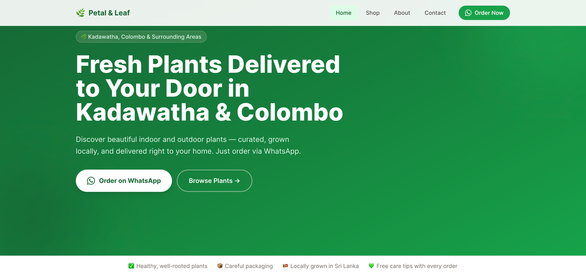

# Petal & Leaf 🌿

A fast, SEO-friendly plant shop for Sri Lanka, built with Next.js. Customers browse the catalogue and order on WhatsApp in one tap.

[](https://github.com/TharaniJDissanayake/Plant-nursery/actions/workflows/ci.yml)

> This is a portfolio project. The shop isn't real, and the WhatsApp number and social links are placeholders.



## Features

- **Plant catalogue:** 8 plants grouped by category, each with price, care tips, light and water needs, and a Sinhala name where relevant.
- **One-tap WhatsApp ordering:** every "Order" button opens WhatsApp with a pre-filled message naming the plant and price.
- **Optimised images:** local photos served through `next/image` as responsive WebP/AVIF, lazy-loaded except for the first row on the shop page.
- **SEO:** JSON-LD structured data, a unique title, description and canonical URL for each page, a generated Open Graph image, `sitemap.xml` and `robots.txt`.
- **Analytics:** Google Analytics 4 with typed custom events for WhatsApp and Instagram clicks.
- **Single source of truth:** every contact and delivery detail lives in [`config/business.ts`](config/business.ts).
- **Quality checks:** Vitest tests and a GitHub Actions pipeline (lint, type-check, test, build) on every PR.

## Tech stack

| Area | Tools |
| --- | --- |
| Framework | [Next.js 15](https://nextjs.org) (App Router, static rendering) and React 19 |
| Language | TypeScript (strict) |
| Styling | Tailwind CSS 3 |
| Analytics | Google Analytics 4 via [`@next/third-parties`](https://nextjs.org/docs/app/guides/third-party-libraries) |
| Testing | Vitest |
| CI | GitHub Actions |
| Hosting | Vercel |

## Running locally

Requires **Node.js 20+**.

```bash
git clone https://github.com/TharaniJDissanayake/Plant-nursery.git
cd Plant-nursery
npm install
cp .env.example .env.local   # optional: add a GA4 ID (see below)
npm run dev
```

Open http://localhost:3000.

| Command | What it does |
| --- | --- |
| `npm run dev` | Start the dev server |
| `npm run build` | Production build |
| `npm start` | Serve the production build |
| `npm run lint` | ESLint (Next.js core-web-vitals and TypeScript rules) |
| `npm run typecheck` | `tsc --noEmit` |
| `npm test` | Run the Vitest suite once |

## Environment variables

| Variable | Required | Description |
| --- | --- | --- |
| `NEXT_PUBLIC_GA_ID` | No | GA4 measurement ID, e.g. `G-XXXXXXXXXX`. If it's empty or missing, the GA script isn't loaded. |

Copy `.env.example` to `.env.local` for local development. `.env.local` is gitignored. On Vercel, set the variable under **Project → Settings → Environment Variables**.

## SEO

- **Structured data (JSON-LD)**
  - Home page: a [`Store`](https://schema.org/Store) (a `LocalBusiness` subtype) with name, description, price range and the delivery areas as `areaServed`. Phone number and social profiles are only published when `isDemo` is `false`.
  - Shop page: an `ItemList` of [`Product`](https://schema.org/Product)s, each with image, `Offer` price in **LKR** and availability.
  - Built in [`lib/structured-data.ts`](lib/structured-data.ts).
- **Metadata:** [`pageMetadata()`](lib/seo.ts) gives each page a unique title, description, canonical URL, and Open Graph and Twitter tags. `metadataBase` makes all of these URLs absolute.
- **Open Graph image:** [`app/opengraph-image.tsx`](app/opengraph-image.tsx) uses `next/og` to generate a 1200×630 PNG at build time from the shop name and tagline.
- **Crawling:** [`app/sitemap.ts`](app/sitemap.ts) and [`app/robots.ts`](app/robots.ts) generate `/sitemap.xml` and `/robots.txt`.
- **Accessibility:** one `<h1>` per page, heading levels never skip, and every image has descriptive alt text.

To check the structured data, paste a page URL into Google's [Rich Results Test](https://search.google.com/test/rich-results).

## Analytics

GA4 loads in [`app/layout.tsx`](app/layout.tsx) only when `NEXT_PUBLIC_GA_ID` is set. Custom events go through a typed helper in [`lib/analytics.ts`](lib/analytics.ts):

```ts
trackEvent("whatsapp_order_click", { location: "plant_card", plant_name: "Anthurium", price: 2200 });
```

`trackEvent` does nothing on the server or when GA isn't loaded, and TypeScript rejects unknown event names or params.

| Event | Params | Fired from |
| --- | --- | --- |
| `whatsapp_order_click` | `location`, plus `plant_name` and `price` on plant cards | `plant_card`, `navbar`, `hero`, `home_cta`, `shop_cta`, `footer`, `contact` |
| `instagram_click` | `location` | `home_cta`, `footer`, `contact` |

Links are wrapped in a small client component, [`TrackedLink`](components/TrackedLink.tsx), so the pages themselves stay server-rendered. To see events live, open GA4 → **Admin → DebugView**, or **Reports → Realtime**.

## Project structure

```
app/
  layout.tsx            Root layout, site-wide metadata, GA4
  page.tsx              Home (Store JSON-LD)
  shop/page.tsx         Catalogue (Product JSON-LD)
  about/page.tsx
  contact/page.tsx
  opengraph-image.tsx   Generated OG image
  sitemap.ts            /sitemap.xml
  robots.ts             /robots.txt
components/
  Navbar.tsx, Footer.tsx, PlantCard.tsx
  TrackedLink.tsx       Link that fires a GA4 event on click
  JsonLd.tsx            Renders a schema.org object safely
config/
  business.ts           Name, contact details, delivery areas, whatsappLink()
data/
  plants.ts             Plant catalogue
lib/
  analytics.ts          Typed trackEvent()
  seo.ts                pageMetadata() helper
  structured-data.ts    Store and Product schema builders
public/images/plants/   Plant photos and CREDITS.md
tests/                  Vitest tests
.github/workflows/      CI pipeline
```

To run this as a real shop, edit [`config/business.ts`](config/business.ts): add the WhatsApp number and social handles, and set `isDemo: false`.

## Image credits

All plant photos are from [Unsplash](https://unsplash.com) and used under the [Unsplash License](https://unsplash.com/license). Photographers: feey, Rashni Parichha, Ka Lee Lip, Vera Cho, Caroline Badran, Aditi T and Sujana Rahman. See [`public/images/plants/CREDITS.md`](public/images/plants/CREDITS.md) for links to each photo.

## How I used Claude Code

**How I planned the work**

- I wrote the initial prompt and split the improvements into six phases: real images, contact details, SEO, Google Analytics, CI and tests, and this README.
- I set the rules for every phase:
  - work on its own Git branch
  - show me a plan before starting
  - pass `npm run build` and `npm run lint` before pushing
  - keep the existing design and copy
  - never commit secrets
- I opened and merged every pull request myself, one phase at a time.

**What Claude Code generated**

- The code for each phase:
  - next/image setup
  - the `config/business.ts` refactor
  - JSON-LD, metadata, sitemap, robots.txt and the Open Graph image
  - GA4 event tracking
  - Vitest tests and the GitHub Actions workflow
  - the first draft of this README
- It found the plant photos on Unsplash and wrote the image credits. It looked at each photo first and replaced several that Unsplash had mislabelled, such as a calla lily tagged as a peace lily.
- It checked its own work before each push: it ran the build, lint and tests, and inspected the pages on a local production server.

**What I reviewed or changed**

- I chose to run the site as a demo with placeholder contact details.
- I asked whether the site was secure and whether anything had leaked. That led to a separate PR that fixed known vulnerabilities in the dependencies, including a critical one in Next.js.
- I took the home page screenshot used above.
